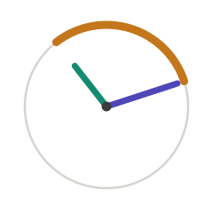
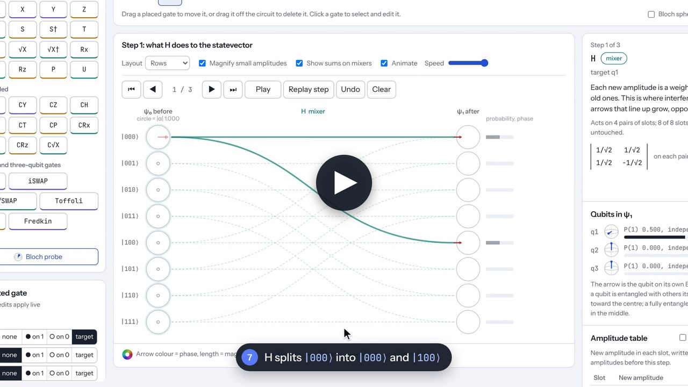

<p align="center">
  
</p>

<h1 align="left">
  Argvec
  <a href="https://argvec.pages.dev/" style="font-size: 0.5em; vertical-align: middle;">[@]</a>
</h1>

Argvec is a browser-based quantum statevector visualizer with a drag-and-drop circuit builder supporting up to 5 qubits. For each quantum gate, it visualizes how the entire statevector evolves and animates the transformation of each complex amplitude.

There's no installing, configuring, or scripting required: just go to https://argvec.pages.dev/, drag gates, and the output displays update in real time.

## Why?

Quantum mechanics is formulated over complex Hilbert spaces. Yet many of our common visual and pedagogical tools translate quantum states into real-valued representations, emphasizing geometry or probabilities over the complex amplitudes themselves.

This project was created out of curiosity for visualizing quantum states in their native complex representation, and how the statevector itself evolves through unitary transformations.

## Demo

[](https://youtu.be/fuFHgfgb93w)

## Features

- Drag gates onto any wire; drag them to move, or off the circuit to delete.
- Pauli, H, S, T, √X, Rx, Ry, Rz, P, U, SWAP, iSWAP and √SWAP, each with any number of controls.
- Amplitudes drawn as arrows (length = magnitude, colour = phase), with animated flows and tip-to-tail sums on mixers.
- An amplitude table and a mover / rotator / mixer label for every step.
- Bloch-sphere probes you can drop anywhere in the circuit.
- Built-in examples, light and dark themes, undo, keyboard shortcuts and touch support.

## Run it

It is a single static page with no build step. Open `index.html`, or serve the folder:

```sh
python3 -m http.server 8000
```

## Tests

```sh
node tests/run.js
```

Checks the gate engine against brute-force matrix multiplication on thousands of random gates.

## Conventions

q1 is the leftmost bit of a basis state, `|q1 q2 q3⟩`. Some libraries, such as Qiskit, use the opposite order.

## License

[MIT](LICENSE)
